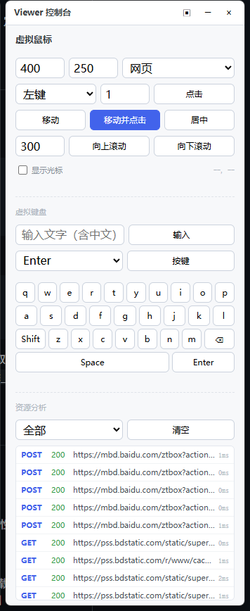
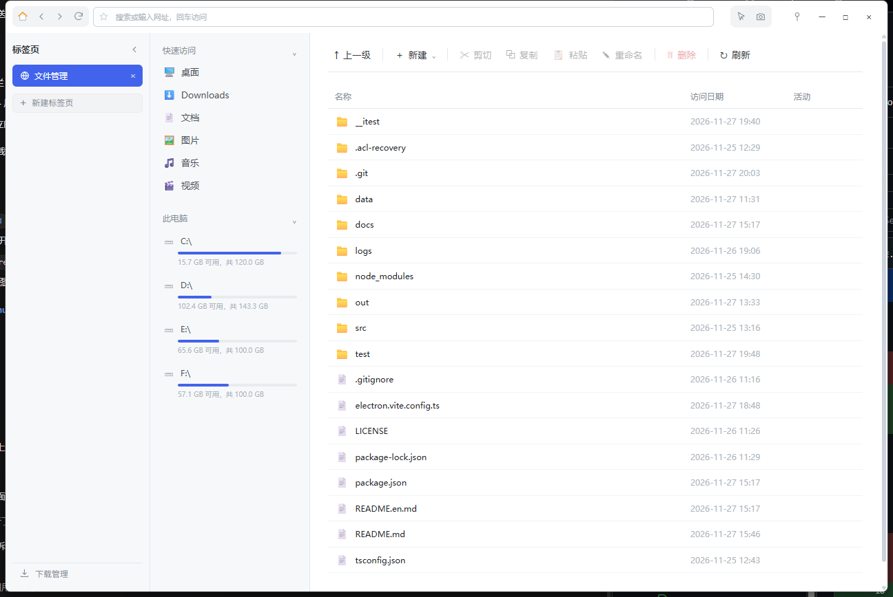

# Viewer

A simple Agent browser. Web pages run in independent `WebContentsView` instances; a virtual mouse and keyboard drive pages through Chromium's trusted input pipeline — the real OS cursor never moves, and no JavaScript is injected into the page.

[中文 README](README.md) · [Design notes](docs/DESIGN.md)

## Screenshots






## Features

- **Self-drawn shell**: frameless window. The toolbar and sidebar each run in their own `WebContentsView` overlay, web pages in another view, and virtual input controls in a separate console window. Drag the empty toolbar area to move the window. Each tab owns a separate `WebContentsView`.
- **Virtual mouse**: a small orange cursor with move, left/right click, repeat clicks (1–10) and wheel scrolling. Per-tab cursor position and visibility. Input uses `webContents.sendInputEvent`, so pages receive `isTrusted=true` events and CSS `:hover` works.
- **Virtual keyboard**: an on-screen English keyboard plus text input (including Chinese) via input events and the system clipboard.
- **File chooser**: CDP intercepts file input requests and Viewer renders its own file browser (drives, parent directory, multi-select, `accept` filtering).
- **Resource analysis**: `session.webRequest` observes requests and shows URL, method, status, type, MIME and duration per tab, with type filters.
- **Links**: `target=_blank` and `window.open` open a new tab instead of a new window.
- **Element inspector**: the crosshair icon next to the address bar enables DevTools-style inspect mode; clicking a page element shows tag, id, classes, size, text and an HTML snippet without injecting scripts. `Esc` exits.
- **Screenshots**: the camera icon saves the visible area as a PNG under `data/screenshots` and shows a thumbnail preview with "open file" and "show in folder" actions.
- **Bookmarks**: star icon or `Ctrl+D` bookmarks the current page; the bookmarks page can open, delete or clear entries (`data/bookmarks.json`).
- **History**: visited pages are recorded (latest entry per URL); the history page can open, delete or clear entries (`data/history.json`).
- **Built-in pages**: `viewer://bookmarks`, `viewer://history` and `viewer://downloads` are separate pages with filtering, open, delete and clear actions.
- **Downloads**: `will-download` is intercepted; files are saved under `data/downloads` with a self-drawn progress page, open/reveal, cancel, retry and clear actions.
- **New tab page**: `viewer://newtab` shows recent bookmarks and history with one-click open.
- **File manager**: `viewer://files` browses drives and quick folders with create, inline rename, copy/cut/paste (including Explorer's system clipboard), delete, copy path, context menu, shortcuts (F2/Delete/Ctrl+C/X/V), directory watching and "open in terminal"; entering an existing local path in the address bar opens it here.
- **File preview**: `viewer://preview` classifies files by content (magic bytes first, extension as fallback): images render as embedded data URLs (20 MB limit), HTML can switch between preview and source, and text supports UTF-8/UTF-16/GB18030 decoding (2 MB limit). Other types open with the system default program; `file://` entries in history are redirected here.

## Install and run

Requires Windows and Node.js 18+.

```bash
git clone https://github.com/SamislandHub/viewer.git
cd viewer
npm install
npm run dev
```

Or from an existing local checkout:

```bash
cd <project-directory>
npm install
npm run dev
```

The renderer URL comes from `ELECTRON_RENDERER_URL` (set by electron-vite with the actual port), with optional `AI_BROWSER_RENDERER_URL` / `VITE_PORT` overrides and a fallback to the built files.

## Usage

- Press Enter in the address bar to navigate; existing local paths open the built-in file manager / preview (`viewer://files` / `viewer://preview`), and only missing paths fall back to `file://`.
- Use the left `+` or `Ctrl+T` for a new tab; loading tabs show a spinner and progress bar.
- Click `▤` in the toolbar to open or close the virtual console (a separate window, hidden and not always-on-top by default).
- The console controls the virtual mouse (X/Y in page or screen coordinates, button, click count, scroll amount) and keyboard.
- The resource panel in the console filters requests by type; clicking a row shows details.
- The star icon or `Ctrl+D` bookmarks the current page; the four buttons at the bottom of the left sidebar open settings, history, bookmarks and downloads.
- The crosshair icon inspects page elements; the camera icon saves a screenshot. Both are in the address bar.
- `test/interaction-test.html` exercises native interactions: file inputs, dialogs, links, mouse events, drag-and-drop, forms, clipboard, fullscreen and more.

## Electron vs Chrome differences

Electron reuses Chromium but is not a full browser. These features exist in Chrome but are missing or behave differently in Electron.

### Dialogs

| API / feature | Electron behavior |
|---|---|
| `window.prompt()` | Unsupported; throws `prompt() is not supported` |
| `window.alert()` / `confirm()` | Supported as blocking native windows, not styleable; Viewer disables them with `disableDialogs` |
| `beforeunload` confirmation | No native prompt; only the `will-prevent-unload` event |
| HTTP auth dialog | No native prompt; only the `login` event, requests fail if unhandled |
| Certificate error / client certificate | No UI; only `certificate-error` / `select-client-certificate` events |

### Built-in browser UI

- **PDF viewer**: Chromium's PDF component is not bundled; integrate pdf.js if needed
- **Download manager / shelf**: Electron only exposes `will-download`; Viewer provides its own download page and progress UI
- **Print preview**: `window.print()` is limited; use `webContents.print()`
- **Find bar, zoom UI, autofill, password manager, translate, Cast, Safe Browsing, component updates**: none; Viewer adds its own bookmarks and history pages
- **Extension store and management UI**: none; extensions support only a subset of APIs

### Web platform APIs

- **File System Access API**: `showOpenFilePicker()` / `showSaveFilePicker()` / `showDirectoryPicker()` are unavailable
- **Web Share, Payment Request**: unsupported
- **Push API**: no FCM push service, effectively unavailable
- **Notification**: works but limited; prefer Electron's native notifications
- **Geolocation, SpeechRecognition**: depend on Google services and often fail by default
- **Widevine / EME DRM**: not bundled; Netflix, Spotify and similar cannot play
- **WebAuthn**: partial support, needs extra configuration
- **Web Bluetooth / USB / Serial / HID**: permission handling is up to the app and platform support varies
- **WebXR**: requires a feature flag

### Deprecated or removed

- `<webview>`: officially discouraged, long-term stability risk
- `BrowserView`: deprecated; use `WebContentsView`
- `remote` module: removed
- NaCl / PNaCl, PPAPI, Flash: removed from Chromium
- `chrome.*` extension APIs: only a subset; most of `chrome.runtime`, `chrome.tabs` and friends are unavailable

### Fingerprint differences

Viewer aligns with Chrome where it can without injecting page scripts; see `src/main/fingerprint.ts`.

Aligned:

- `navigator.userAgent` no longer contains `Electron/x.y.z`; it reports `Chrome/<major>.0.0.0` matching the bundled Chromium
- `navigator.userAgentData.brands` includes `Google Chrome` via CDP `Emulation.setUserAgentOverride`
- `navigator.userAgentData.platform` / `navigator.platform`: `Windows` / `Win32`
- `navigator.languages`: `zh-CN, zh, en`
- `navigator.webdriver`: `false`
- `navigator.vendor`: `Google Inc.`
- `navigator.plugins` / `mimeTypes`: match Chromium (five PDF-related plugins)
- `navigator.pdfViewerEnabled`: `true`

Still different, and only fixable by injecting a script:

- `window.chrome` exists but `chrome.runtime` is missing
- `Notification.permission` defaults to `granted`; Chrome reports `default`
- `window.chrome` has no enumerable properties

## Known limitations

- `alert` / `confirm` are disabled via `disableDialogs`: `alert` returns immediately, `confirm` always returns `false`, and `prompt` returns `null`. Confirmation flows should use in-page dialogs.
- Resource analysis records metadata only; response bodies would require CDP and are intentionally out of scope.
- File preview supports images (≤20 MB), HTML and common text files (≤2 MB); other types open in the system default program. Content-based detection may disagree with a misleading extension.
- The file chooser requires a trusted user gesture; scripted `input.click()` does not trigger it.
- Windows only.
- **Third-party IME compatibility**: if the Doubao IME makes physical keyboard input stop working in this app (cursor blinks but keys are swallowed), this is an IME/Electron compatibility issue, not Viewer code — it also reproduces in a clean Electron window, while Microsoft Pinyin works. Switch to a built-in Windows IME or wait for an IME fix.

## Development

`src/main/index.ts` wires IPC and window events; `browser.ts` manages tabs, toolbar/sidebar overlay views and the cursor view; `virtual-mouse.ts` and `virtual-keyboard.ts` implement input; `resource-monitor.ts` observes requests; `fingerprint.ts` aligns UA/Client Hints; `dialog-bridge.ts` handles CDP file chooser and element inspection; `bookmarks.ts`, `history.ts` and `downloads.ts` provide persistence and download management; `src/shared/file-types.ts` is the shared content-based file classifier. `src/renderer/toolbar.html` and `sidebar.html` are the toolbar and sidebar views; `index.html` and `controls.html` are the shell and separate console; `newtab.html`, `files.html`, `preview.html`, `bookmarks.html`, `history.html`, `downloads.html`, `settings.html` and `home.html` back the built-in pages. Edits under `src/main` require an app restart; renderer edits take effect after the next build. Run `npm run typecheck` and `npm run build`.

## License

[MIT](LICENSE) © 2026 SamislandHub
