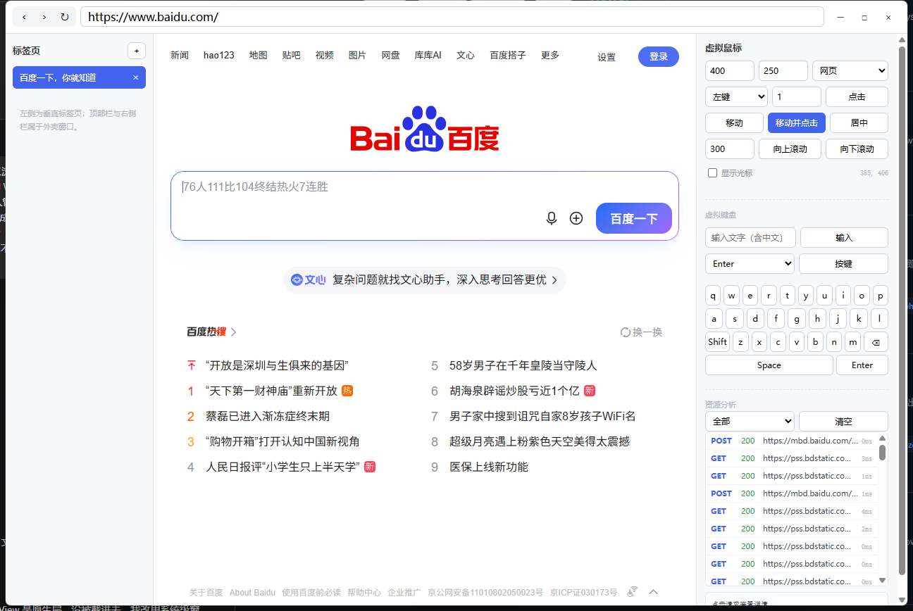
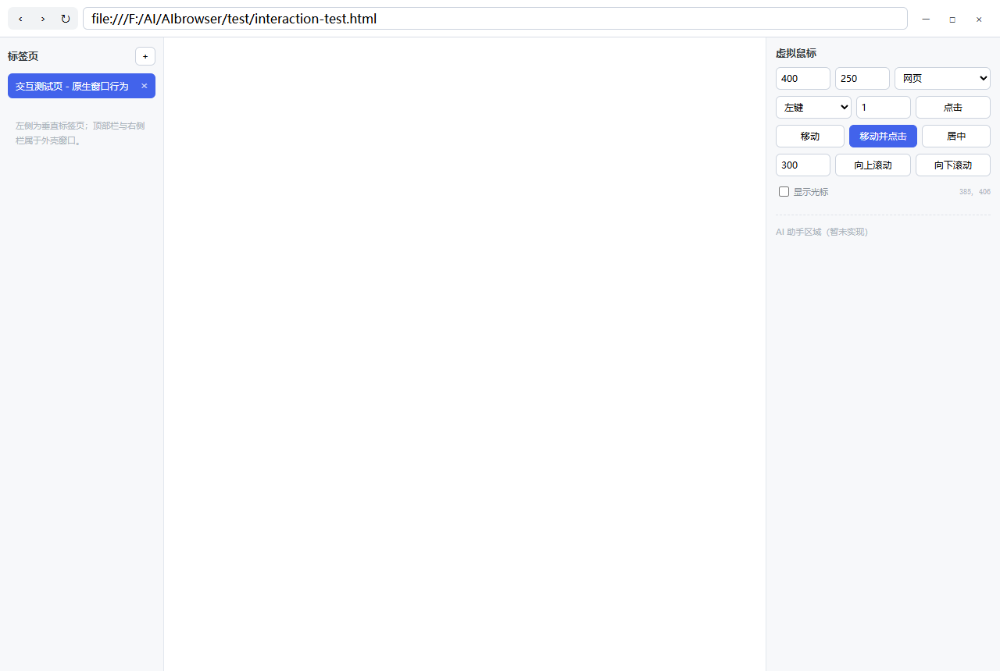

# Viewer

A simple Agent browser. Web pages run in independent `WebContentsView` instances; a virtual mouse and keyboard drive pages through Chromium's trusted input pipeline — the real OS cursor never moves, and no JavaScript is injected into the page.

[中文 README](README.md) · [Design notes](docs/DESIGN.md)

## Screenshots





## Features

- **Self-drawn shell**: frameless window, top toolbar, vertical tab strip on the left, tool panel on the right. Each tab owns a separate `WebContentsView`.
- **Virtual mouse**: a small orange cursor with move, left/right click, repeat clicks (1–10) and wheel scrolling. Per-tab cursor position and visibility. Input uses `webContents.sendInputEvent`, so pages receive `isTrusted=true` events and CSS `:hover` works.
- **Virtual keyboard**: an on-screen English keyboard plus text input (including Chinese) via input events and the system clipboard.
- **File chooser**: CDP intercepts file input requests and Viewer renders its own file browser (drives, parent directory, multi-select, `accept` filtering). This is the only CDP-based feature.
- **Resource analysis**: `session.webRequest` observes requests and shows URL, method, status, type, MIME and duration per tab, with type filters.
- **Links**: `target=_blank` and `window.open` open a new tab instead of a new window.

## Install and run

Requires Windows and Node.js 18+.

```bash
git clone https://github.com/SamislandHub/viewer.git
cd viewer
npm install
npm run dev
```

Or from an existing local checkout:

```bash
cd <project-directory>
npm install
npm run dev
```

The renderer URL comes from `ELECTRON_RENDERER_URL` (set by electron-vite with the actual port), with optional `AI_BROWSER_RENDERER_URL` / `VITE_PORT` overrides and a fallback to the built files.

## Usage

- Press Enter in the address bar to navigate; local Windows paths are converted to `file://` URLs.
- Use the left `+` or `Ctrl+T` for a new tab; loading tabs show a spinner and progress bar.
- The right panel controls the virtual mouse (X/Y in page or screen coordinates, button, click count, scroll amount) and keyboard.
- The resource panel filters requests by type; clicking a row shows details.
- `test/interaction-test.html` exercises native interactions: file inputs, dialogs, links, mouse events, drag-and-drop, forms, clipboard, fullscreen and more.

## Known limitations

- `alert`, `confirm` and `beforeunload` are not intercepted: WebContentsView cannot suppress Electron's default dialogs; the `js-dialog` event only fires on `<webview>` guests.
- `window.prompt` is disabled by Electron and produces no event.
- The small cursor area (about 34×28 px) intercepts real mouse events; the rest of the page behaves normally.
- Resource analysis records metadata only; response bodies would require CDP and are intentionally out of scope.
- The file chooser requires a trusted user gesture; scripted `input.click()` does not trigger it.
- Windows only.

## Development

`src/main/index.ts` wires IPC and window events; `browser.ts` manages tabs and the cursor view; `virtual-mouse.ts` and `virtual-keyboard.ts` implement input; `resource-monitor.ts` observes requests; `src/renderer/` contains the self-drawn UI. Edits under `src/main` require an app restart; renderer edits take effect after the next build. Run `npm run typecheck` and `npm run build`.

## License

[MIT](LICENSE) © 2026 SamislandHub
