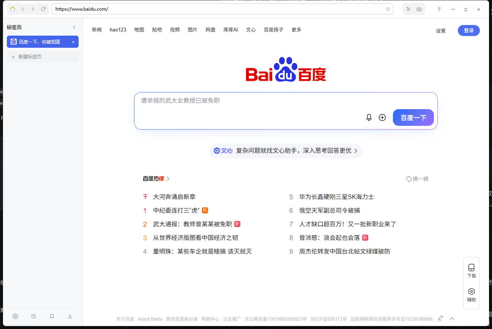
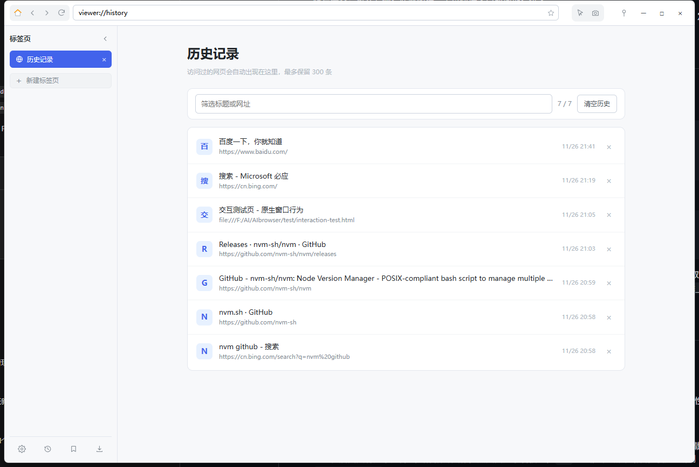
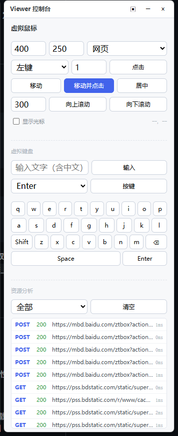
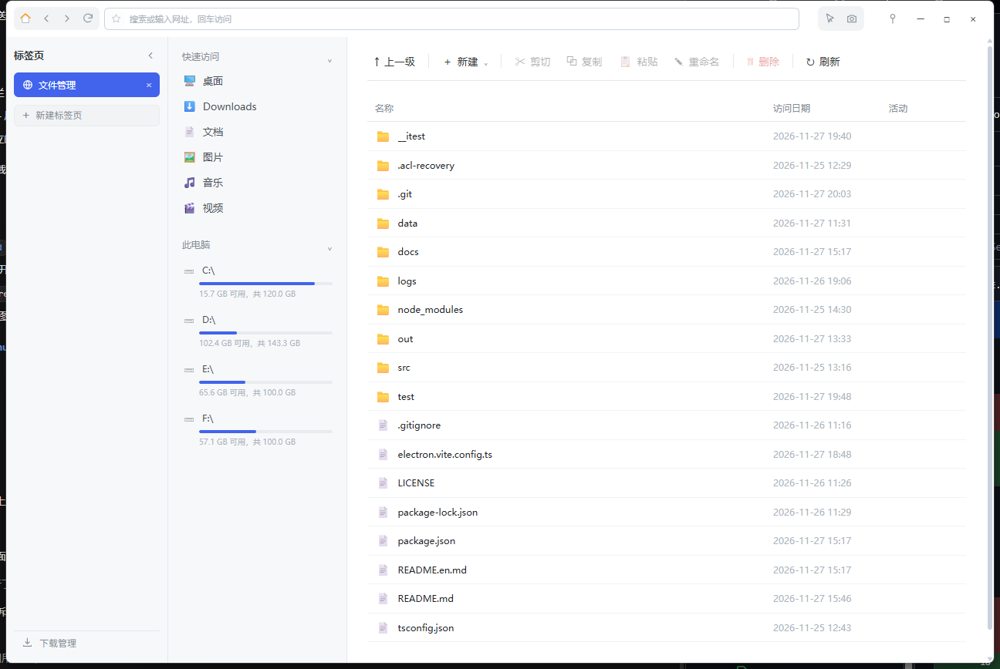

# Viewer

一个简单的 Agent 浏览器，网页运行在独立的 `WebContentsView` 中；支持虚拟鼠标与虚拟键盘，通过 Chromium 的可信输入管线操作页面，不移动真实系统光标，也不向页面注入 JavaScript。

[English README](README.en.md) · [设计文档](docs/DESIGN.md)

## 截图









## 功能

- **自绘浏览器外壳**：无边框窗口；工具栏和侧边栏分别运行在独立的 `WebContentsView` 覆盖层上，网页在另一个独立 View 中，虚拟输入控件在独立的控制台窗口中。工具栏空白处可拖动窗口。每个标签是一个独立的 `WebContentsView`。
- **虚拟鼠标**：可见的橙色光标，支持移动、左键/右键、连击（1–10 次）、滚轮；每个标签独立保存光标位置与显示状态。点击通过 `webContents.sendInputEvent` 注入，页面收到 `isTrusted=true` 的事件，CSS `:hover` 正常生效。
- **虚拟键盘**：英文键盘与文字输入（含中文），通过 `sendInputEvent` 与系统剪贴板实现，同样不注入页面 JS。
- **文件选择器**：通过 CDP 拦截文件选择请求，在应用内展示自绘的文件浏览器（磁盘/上一级/多选/accept 过滤）；这是唯一使用 CDP 的场景。
- **资源分析**：用 `session.webRequest` 观察请求，按标签展示 URL、方法、状态、类型、MIME、耗时与错误，可过滤 XHR/文档/脚本/样式/图片。
- **链接处理**：`target=_blank` 与 `window.open` 转为新标签页，不弹新窗口。
- **元素选择**：地址栏后的准星图标开启 DevTools 式选取模式，点击页面元素即可查看标签、ID、类名、尺寸、文本与 HTML 片段（CDP Overlay，不注入脚本）；`Esc` 退出。
- **截图**：相机图标把当前可视区域保存为 PNG 到 `data/screenshots`，并弹出缩略图预览，可直接打开文件或定位到文件夹。
- **收藏 / 书签**：地址栏右侧星标收藏当前页（`Ctrl+D` 切换）；收藏页可打开、删除或清空条目，数据保存在 `data/bookmarks.json`。
- **历史记录**：自动记录访问过的网页（同一网址只保留最新一条）；历史页可打开、单条删除或一键清空，数据保存在 `data/history.json`。
- **内置页面**：`viewer://bookmarks`、`viewer://history`、`viewer://downloads` 三个独立页面，支持筛选、打开、删除与清空；可从左侧栏底部图标、主页快捷入口或地址栏进入。
- **下载管理**：接管 `will-download`，文件统一保存到 `data/downloads`；独立页面显示进度，支持打开、定位、取消、中断重试与清除记录。
- **新标签页**：`viewer://newtab` 展示最近收藏与历史记录，可一键打开或进入完整页面。
- **文件管理器**：`viewer://files` 提供磁盘/快捷目录浏览、新建、行内重命名、复制/剪切/粘贴（兼容资源管理器系统剪贴板）、删除、复制路径、右键菜单、快捷键（F2/Delete/Ctrl+C/X/V）、目录变更监听与在终端打开；地址栏输入本地路径自动进入（`viewer://files/<路径>`）。
- **文件预览**：`viewer://preview` 按**文件内容**识别类型（魔数优先、扩展名兜底）：图片以内嵌 data URL 显示（上限 20 MB），HTML 可在预览/源码间切换，文本支持 UTF-8/UTF-16/GB18030 解码（上限 2 MB）；其他类型可调用系统程序打开。历史中的 `file://` 本地文件也会自动转到预览页。

## 安装与运行

需要 Windows 与 Node.js 18+。

从 GitHub 获取：

```bash
git clone https://github.com/SamislandHub/viewer.git
cd viewer
npm install
npm run dev
```

从本地目录运行：

```bash
cd <项目目录>
npm install
npm run dev
```

`npm run dev` 会用 electron-vite 构建主进程、preload 与界面，然后启动 Electron。渲染界面的地址优先取 `ELECTRON_RENDERER_URL`（electron-vite 自动注入实际端口），也可通过 `AI_BROWSER_RENDERER_URL` 或 `VITE_PORT` 覆盖；加载失败会回退到构建好的本地文件。

## 使用

- 地址栏输入网址或搜索词后回车；存在的本地路径或目录会打开内置文件管理器/预览（`viewer://files` / `viewer://preview`），不存在的路径才回退到 `file://`。
- 左侧 `+` 或 `Ctrl+T` 新建标签；点击标签切换；标签加载时显示旋转指示与进度条。
- 点工具栏 `▤` 打开/关闭「虚拟控制台」（独立窗口，默认隐藏、默认不置顶）。
- 控制台「虚拟鼠标」区设置 X/Y（网页/屏幕坐标）、按键、连击次数与滚动量；「显示」控制光标可见性。
- 控制台「虚拟键盘」区可输入文字或点英文键盘；中文通过系统剪贴板 + Ctrl+V 注入。
- 控制台「资源分析」区按类型过滤请求，点击行查看详情；「清空」只清当前标签。
- 地址栏右侧星标收藏当前页（`Ctrl+D`）；左侧栏底部四个按钮依次打开设置、历史记录、收藏夹、下载管理页面。地址栏后面只有元素选择（鼠标指针图标，点页面元素看信息，`Esc` 退出）和截图（保存可视区域到 `data/screenshots`）。

测试页：`test/interaction-test.html` 覆盖文件选择、弹窗、链接、鼠标事件、拖拽、表单、剪贴板、全屏等原生交互。

## Electron 与 Chrome 的差异

Electron 复用了 Chromium 内核，但不是一个完整浏览器。以下功能在 Chrome 里可用，在 Electron 里缺失或行为不同。

### 对话框

| API / 功能 | Electron 表现 |
|---|---|
| `window.prompt()` | 不支持，调用抛 `prompt() is not supported` |
| `window.alert()` / `confirm()` | 支持，但会弹阻塞式原生窗口，样式不可定制；Viewer 已用 `disableDialogs` 关闭 |
| `beforeunload` 确认框 | 不弹原生框，只有 `will-prevent-unload` 事件 |
| HTTP 认证框 | 不弹，只有 `login` 事件，不处理则请求失败 |
| 证书错误 / 客户端证书选择 | 不弹 UI，只有 `certificate-error` / `select-client-certificate` 事件 |

### 浏览器自带 UI

- **PDF 阅读器**：未打包 Chromium PDF 组件，需要自行集成 pdf.js
- **下载管理器 / 下载栏**：原生没有下载 UI；Viewer 已接管 `will-download`，提供自绘下载页面
- **打印预览**：`window.print()` 受限，需用 `webContents.print()`
- **查找栏、缩放 UI、书签、历史、自动填充、密码管理器、翻译、Cast、Safe Browsing、组件更新**：均无
- **扩展商店与扩展管理 UI**：无，扩展仅支持部分 API

### Web 平台 API

- **File System Access API**：`showOpenFilePicker()` / `showSaveFilePicker()` / `showDirectoryPicker()` 不可用
- **Web Share、Payment Request**：不支持
- **Push API**：缺少 FCM 推送服务，基本不可用
- **Notification**：可用但受限，建议使用 Electron 原生通知
- **Geolocation、SpeechRecognition**：依赖 Google 服务，默认经常不可用
- **Widevine / EME DRM**：不内置，Netflix、Spotify 等无法播放
- **WebAuthn**：支持不完整，需要额外配置
- **Web Bluetooth / USB / Serial / HID**：需要自行处理权限，部分平台受限
- **WebXR**：需要手动开启 feature flag

### 已废弃或移除

- `<webview>`：官方不推荐，长期有稳定性风险
- `BrowserView`：已废弃，改用 `WebContentsView`
- `remote` 模块：已移除
- NaCl / PNaCl、PPAPI、Flash：Chromium 层面已彻底移除
- `chrome.*` 扩展 API：仅实现子集，`chrome.runtime`、`chrome.tabs` 等大部分不可用

### 指纹差异

Viewer 会在不注入页面脚本的前提下尽量对齐 Chrome，实现见 `src/main/fingerprint.ts`。

已对齐：

- `navigator.userAgent`：不再包含 `Electron/x.y.z`，而是与内置 Chromium 版本一致的 `Chrome/<major>.0.0.0`
- `navigator.userAgentData.brands`：通过 CDP `Emulation.setUserAgentOverride` 补上 `Google Chrome`
- `navigator.userAgentData.platform` / `navigator.platform`：`Windows` / `Win32`
- `navigator.languages`：`zh-CN, zh, en`
- `navigator.webdriver`：`false`
- `navigator.vendor`：`Google Inc.`
- `navigator.plugins` / `mimeTypes`：与 Chromium 一致（5 个 PDF 相关插件）
- `navigator.pdfViewerEnabled`：`true`

仍存在、且必须注入脚本才能改的：

- `window.chrome` 对象存在，但 `chrome.runtime` 缺失
- `Notification.permission` 默认是 `granted`，Chrome 是 `default`
- `window.chrome` 的可枚举属性为空

## 已知限制

- `alert` / `confirm` 已通过 `disableDialogs` 直接禁用：`alert` 立即返回，`confirm` 固定返回 `false`，`prompt` 返回 `null`。需要用户确认的业务逻辑应改用页面内自定义弹框。
- 资源分析只记录请求元数据，不记录响应 body——读取 body 需要 CDP，按设计边界未启用。
- 文件预览只支持图片（≤20 MB）、HTML 与常见文本（≤2 MB）；其他类型需用系统程序打开。伪装扩展名的文件按内容识别，可能与扩展名不同。
- 文件选择器需要可信用户手势触发；脚本式 `input.click()` 不算手势。
- 仅支持 Windows（界面与输入注入依赖 Electron Windows 行为）。
- **第三方输入法兼容性**：如果使用豆包输入法且更新后在本应用中出现“输入框光标闪动但物理键盘完全无反应”，这不是本应用代码问题——最早版本和一个不加载本应用代码的干净 Electron 窗口都能复现，而微软拼音正常。推测是豆包输入法新版本对 Electron/Chromium 窗口的兼容处理导致按键被吞掉。临时解决：切换到微软拼音等系统自带输入法，或等待豆包输入法修复。

## 开发

| 文件 | 作用 |
|---|---|
| `src/main/index.ts` | 入口、IPC、窗口事件、URL 解析、资源推送 |
| `src/main/browser.ts` | 外壳窗口、多标签、光标 View、文件选择状态 |
| `src/main/virtual-mouse.ts` | 每标签的虚拟鼠标状态与输入注入 |
| `src/main/virtual-keyboard.ts` | 文字与按键输入 |
| `src/main/resource-monitor.ts` | `session.webRequest` 资源采集 |
| `src/main/fingerprint.ts` | UA 与 Client Hints 对齐（无脚本注入） |
| `src/main/dialog-bridge.ts` | CDP 文件选择拦截 + 元素选择（同一调试会话） |
| `src/main/bookmarks.ts` | 收藏夹持久化（`data/bookmarks.json`） |
| `src/main/history.ts` | 历史记录持久化（`data/history.json`） |
| `src/main/downloads.ts` | 下载接管与进度跟踪（`data/downloads`） |
| `src/shared/file-types.ts` | 文件类型识别（魔数 + 扩展名，供主进程与预览页共用） |
| `src/renderer/toolbar.html` / `sidebar.html` | 独立工具栏 View / 侧边栏 View |
| `src/renderer/index.html` / `controls.html` | 主外壳 / 独立控制台 |
| `src/renderer/newtab.html` | 新标签页（收藏与历史） |
| `src/renderer/files.html` / `preview.html` | 文件管理器 / 文件预览 |
| `src/renderer/bookmarks.html` / `history.html` / `downloads.html` | 收藏页 / 历史页 / 下载页（对应 `viewer://` 内置地址） |

修改 `src/main` 需重启应用；修改 `src/renderer` 在下次构建后生效。运行 `npm run typecheck` 做类型检查，`npm run build` 生成 `out/`。

## 许可证

[MIT](LICENSE) © 2026 SamislandHub
